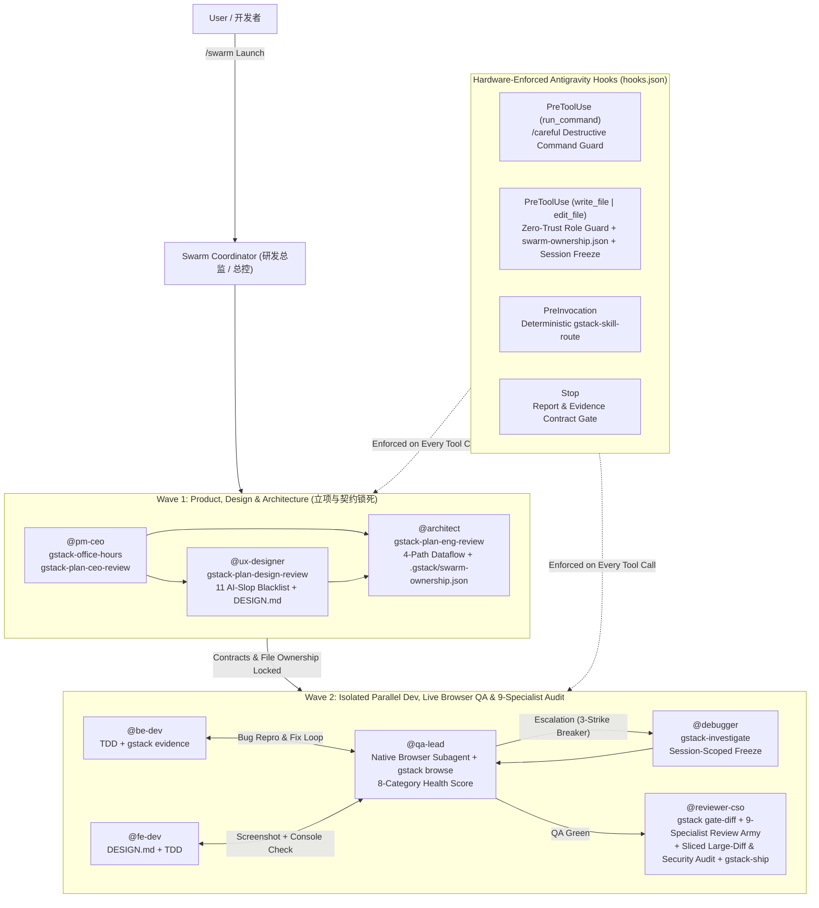

# Antigravity GStack Swarm (`antigravity-gstack-swarm`)

> **Full-Runtime Port of [Garry Tan's `gstack`](https://github.com/garrytan/gstack) + Zero-Trust Multi-Agent Swarm Engine for Google Antigravity 2.0**
>
> 将 Y Combinator 总裁 Garry Tan 开源的 [`garrytan/gstack`](https://github.com/garrytan/gstack) 全部底层能力（**65 个编译技能、170+ CLI 防伪账本与扫描器、4 大原生编译/渲染引擎、9 专家并行审查团、超 2 MB 大 diff 切片评审与大型 PR `/gstack-ship` 支持**）深度移植至 **Google Antigravity 2.0 IDE**，并与原生 **`/swarm` 多智能体共享看板**及**硬件级零信任文件隔离钩子（`hooks.json`）**无缝融合，打造一支真正按硅谷互联网公司全建制运转的 AI 研发团队。

[](https://github.com/cxbrucewayen/antigravity-gstack-swarm/actions/workflows/ci.yml)
[](./LICENSE)
[](#quick-start--一键安装)
[](#architecture--核心架构)

---

## Why This Exists / 为什么要做这个项目？

Upstream [`garrytan/gstack`](https://github.com/garrytan/gstack) is an extraordinary virtual engineering workflow, **but out of the box on Antigravity 2.0 IDE**:
1. Upstream `--host agy` only targets the legacy CLI path (`~/.gemini/antigravity-cli/skills`), **not Antigravity 2.0 IDE** (`~/.gemini/config/plugins/`).
2. Upstream marks Antigravity safety hooks as `advisory` (warnings only, **zero enforcement**), and **suppresses `REVIEW_ARMY`** (the 9 parallel code-review specialists).
3. Upstream `gstack` runs roles **serially in one chat**, and its `/freeze` lock is a **single global file** (`~/.gstack/freeze-dir.txt`) — meaning if a debugger locks `src/auth`, a parallel frontend agent editing `src/ui` gets blocked too.

**`antigravity-gstack-swarm` solves all of these and goes further:**

| Capability / 能力对比 | Upstream `gstack` (`--host agy`) | `antigravity-gstack-swarm` (This Repo) |
| :--- | :---: | :---: |
| **Antigravity 2.0 Global Plugin (`~/.gemini/config/plugins/`)** | No | **Yes (65 Skills + Rules + Hooks)** |
| **Compiled Native Engines (`browse`, `design`, `make-pdf`, `diagram-render`)** | Manual / Partial on Win | **1-Click Automated Build (Win/macOS/Linux)** |
| **170+ CLI Ledgers (`wtree`, `evidence`, `gate-diff`, `state-matrix`, `learnings`)** | Bash-only | **Universal `gstack` CLI in PowerShell, CMD & Bash** |
| **9-Specialist Parallel Review Army (`REVIEW_ARMY`)** | Suppressed | **Fully Unlocked & Wired to Subagents / Swarm** |
| **Lifecycle Safety Hooks (`/careful`, `/freeze`, `skill-route`, `Stop` gate)** | Advisory only | **Hardware-Enforced via Native `hooks.json`** |
| **Multi-Agent Parallel Execution (`/swarm` Shared Board)** | Serial single-agent | **Full 8-Role Concurrent Swarm Pipeline** |
| **Zero-Trust Auto-Role File Guards & Session-Scoped Freeze** | None (Global-only freeze) | **Auto-detects `@role` from Transcript + `.gstack/swarm-ownership.json`** |

---

## Architecture / 核心架构



---

## Key Innovations / 五大核心特性

### 1. Full Internet-Company Role Roster on `/swarm`（完备互联网研发军团编制）
- **`@pm-ceo`** (`gstack-office-hours`, `gstack-plan-ceo-review`): Six forcing questions, anti-sycophancy premise challenge, narrowest MVP wedge, 4 scope modes.
- **`@ux-designer`** (`gstack-plan-design-review`, `gstack-design-consultation`, `gstack-design-shotgun`, `gstack-design-html`): 4 surface classifiers, 7-pass scoring, **11-item AI Slop Blacklist**, 5 interaction states (`Loading / Empty / Error / Success / Partial`), and live HTTP comparison boards (`gstack design`).
- **`@architect`** (`gstack-plan-eng-review`, `gstack-diagram`): Happy/Nil/Empty/Error ASCII dataflows, state-machine validation (`gstack state-matrix`), Error & Rescue matrices, shared contract scaffolding, and `.gstack/swarm-ownership.json`.
- **`@be-dev` / `@fe-dev`** (`gstack-build-check`): Strict Reuse Ladder + Red-Green-Refactor TDD, producing cryptographic working-tree test receipts via `gstack evidence run`.
- **`@debugger`** (`gstack-investigate`): Iron Law (*"No fixes without root cause investigation first"*), **3-Strike Hypothesis Circuit Breaker** (auto-stops and escalates after 3 failed hypotheses), and **Session-Scoped Freeze** (`freeze-session`).
- **`@qa-lead`** (`gstack-qa`, `gstack-browse`): Dual-engine live E2E verification combining Antigravity's visual `browser` subagent and `gstack browse` (~100ms/op Chromium daemon), mobile `375x812` checks, and the 8-dimension Health Score Rubric.
- **`@reviewer-cso`** (`gstack-review`, `gstack-test-audit`, `gstack-ship`): Runs `gstack gate-diff` (catches `RH-1..RH-16` deleted/weakened tests), dispatches the **9-Specialist Parallel Review Army** (with automatic >2 MB large-diff slicing via `gstack review-dispatch`), runs Sideways Sweep + direct OWASP/STRIDE security audit (aligned with upstream gstack v1.104+ removal of `/cso`), supports large-PR `/gstack-ship`, and stamps `gstack review-log` receipts.

### 2. Zero-Trust Automatic Role & File-Ownership Hardware Locks（零信任角色自动识别硬件锁）
`plugin/hooks/pre-tool-write.mjs` inspects the Antigravity `transcriptPath` on `write_file` / `edit_file` to identify `/swarm` workers automatically from Turn 1:
- **Zero-Config Invariants**: `@pm-ceo` is blocked at the hook layer from writing `.ts/.js/.py/.go/.rs` source code; `@qa-lead` and `@reviewer-cso` are blocked from modifying `src/` product files (preventing Verifier-vs-Author file collisions while permitting `tests/` and `.gstack/`).
- **Project Ownership Matrix**: Drop a `.gstack/swarm-ownership.json` (see [`examples/swarm-ownership.example.json`](./examples/swarm-ownership.example.json)) to hard-lock `@be-dev` to `src/server/**` and `@fe-dev` to `src/client/**`.
- **Session-Scoped `/freeze`**: `gstack swarm-lock freeze-session --session <id> --dir src/auth` locks *only* `@debugger`'s session without blocking concurrent teammates.

### 3. Cryptographic Verification Ledgers & Gate Integrity（防伪测试回执与门禁完整性扫描）
Every `170+` upstream CLI works natively via `gstack <subcommand>`:
```powershell
gstack wtree                                               # Content hash of tracked + untracked tree (40x faster via index stat-cache)
gstack evidence run --label unit -- npm test               # Binds test exit code & log to exact working-tree hash
gstack evidence check --label unit                         # Grades FRESH / STALE / MISSING
gstack gate-diff main                                      # Flags RH-1..RH-16 weakened assertions, skipped tests, or pragma suppressions
gstack learnings-search --limit 5 --query "auth"           # Compounding cross-session project memory
gstack doctor                                              # Full installation health audit
```

---

## Quick Start / 一键安装

### Windows (PowerShell 7+ & Git for Windows)
> Prerequisites: [Node.js >= 20](https://nodejs.org/) and [Git for Windows](https://git-scm.com/) (includes Git Bash). Bun and `jq` are installed automatically if missing.

```powershell
git clone https://github.com/cxbrucewayen/antigravity-gstack-swarm.git
cd antigravity-gstack-swarm
pwsh -ExecutionPolicy Bypass -File .\install.ps1
```

### macOS & Linux
> Prerequisites: `node >= 20`, `git`, and `jq`. Bun is installed automatically if missing.

```bash
git clone https://github.com/cxbrucewayen/antigravity-gstack-swarm.git
cd antigravity-gstack-swarm
bash ./install.sh
```

---

## Ready-to-Use `/swarm` Prompts / 一键启动口令

Once installed, open any workspace in **Google Antigravity 2.0** and run:

### 1. Full 0-to-1 Product Sprint（从需求诊断到上线的全建制冲刺）
```text
/swarm 启动 gstack-swarm 全引擎团队，帮我设计并开发：【你的项目或新特性描述】。先由 pm-ceo、ux-designer、architect 完成痛点收敛、反塑料感 DESIGN.md 与架构契约及 .gstack/swarm-ownership.json 切分；再并行推进前后端 TDD 开发、真实浏览器 QA 八维验收与 9 专家代码安全终审。
```

### 2. Root-Cause Bug Investigation Squad（3 次熔断 + 会话隔离锁排障小组）
```text
/swarm 启动 gstack-swarm 排障组，调查并根治以下故障：【粘贴报错堆栈或复现现象】。严格执行未查明根因禁改代码、会话级 freeze 目录锁、3 次假设失败熔断、红灯回归测试与 gstack evidence 防伪凭证留存。
```

### 3. Pre-Ship Audit & Browser QA Gate（上线前代码、UI 与安全并发门禁）
```text
/swarm 启动 gstack-swarm 上线门禁，并发执行 gstack gate-diff 门禁防篡改扫描、9 专家 Review Army 代码审查（含超 2 MB 大 diff 切片评审）、直接 OWASP/STRIDE 安全审计与真实浏览器 QA 走查打分。
```

---

## Running Tests / 运行自动化测试

```bash
npm test
```

---

## Credits & License / 致谢与开源协议

- Built upon and inspired by **[`garrytan/gstack`](https://github.com/garrytan/gstack)** created by [Garry Tan](https://github.com/garrytan) (MIT License).
- Released under the [MIT License](./LICENSE).
